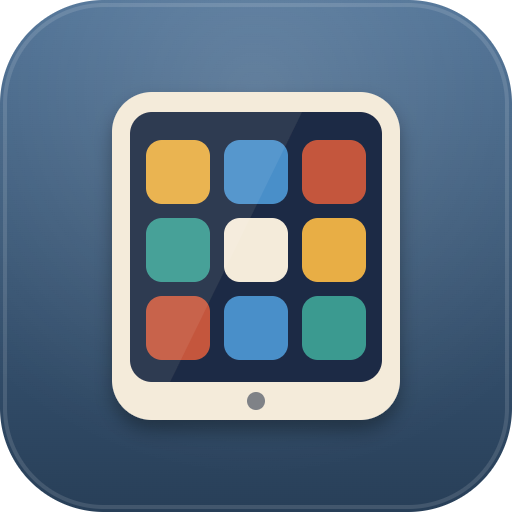
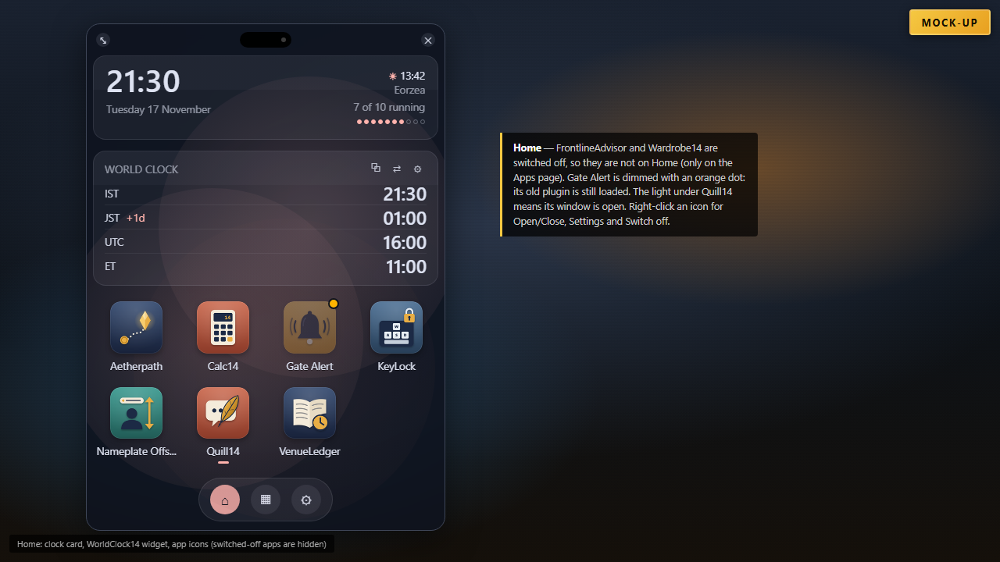
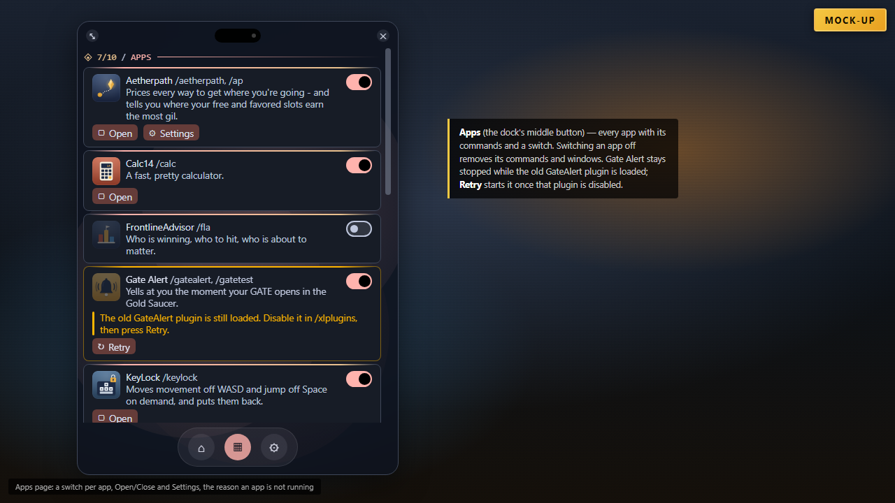
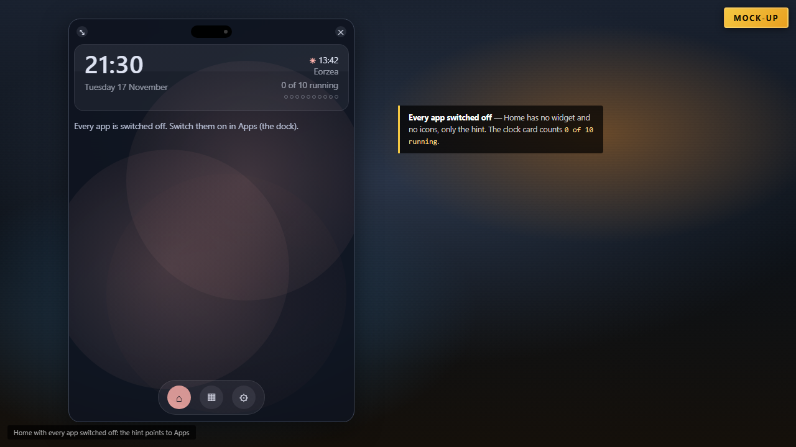
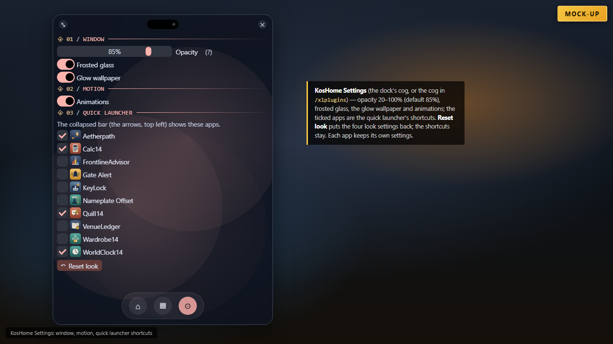
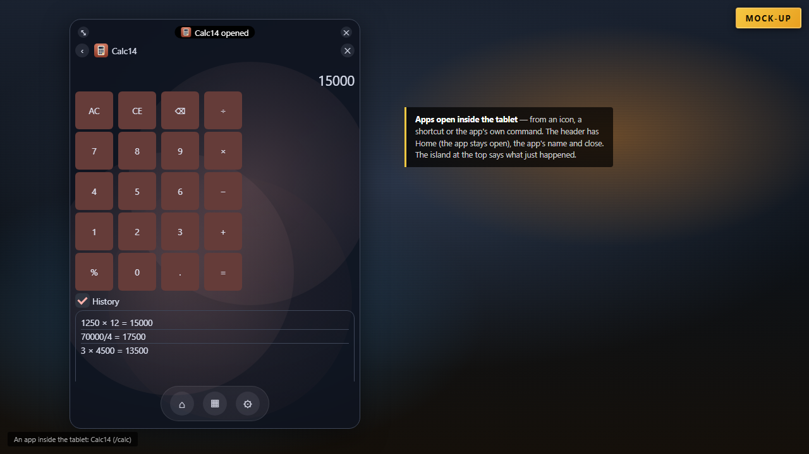
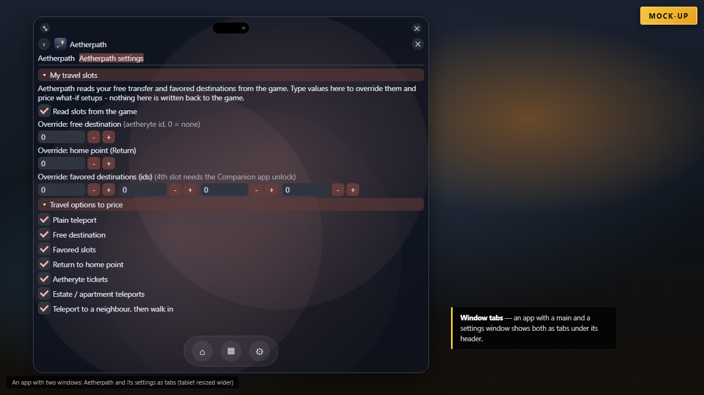

# KosHome

One home for the PriestKos plugin tools. Ten former standalone Dalamud plugins live here as **apps** you switch on
and off from one window, laid out like a tablet: a home screen of app icons on frosted glass.

`/koshome` · Dalamud API 15 · .NET 10

> **No support will be provided. This software is to be used as is, without warranty of any kind.**

## Screenshots

These images are **mock-ups** (HTML rendered to PNG). They are not real in-game captures and do not show the actual FFXIV client UI.

| | |
| --- | --- |
|  | **Home** — clock card, WorldClock14 widget, an icon per app that is on. Two apps are off and not shown; Gate Alert is dimmed (its old plugin is still loaded). |
|  | **Apps page** — a switch per app, Open/Close, Settings, and why an app is not running. |
|  | **Every app switched off** — Home shows only the hint. |
|  | **KosHome Settings** — look, motion and the quick launcher's shortcuts. |
|  | **An app inside the tablet** — Calc14 under the app header. |
|  | **Window tabs** — Aetherpath's two windows as tabs (tablet resized wider). |

### Mock-up video

A short **mock-up** walkthrough (not real gameplay) cross-fades through the same surfaces plus the quick launcher, with captions. The gold **Mock-up** label stays visible for the whole clip.

- [mockup-walkthrough.mp4](docs/videos/mockup-walkthrough.mp4) (H.264, 1280×720, ~15 s)
- [mockup-walkthrough.gif](docs/videos/mockup-walkthrough.gif) (preview)

## What it does

| App | What it does |
|---|---|
| Aetherpath | Prices every way to get where you're going, and where your free and favored slots earn the most gil. |
| Calc14 | A fast, pretty calculator. |
| FrontlineAdvisor | Who is winning, who to hit, who is about to matter. |
| Gate Alert | Yells at you the moment your GATE opens in the Gold Saucer. |
| KeyLock | Moves movement off WASD and jump off Space on demand, and puts them back. |
| Nameplate Offset | Raise or lower the nameplate above a character's head. |
| Quill14 | Roleplay posts: smart splitting, markup, templates and paced sending. |
| VenueLedger | Every venue you know, on one clock. |
| Wardrobe14 | A cross-collection view of your Penumbra mods. |
| WorldClock14 | A home-screen widget: your timezones live, one click to copy for chat. |

- **All apps start switched on.** Switching one off removes its commands and windows until it is back on.
- **Home** has a clock card (local time, Eorzea time, "N of 10 running"), the WorldClock14 widget (click a zone to copy
  it for chat; buttons copy all, open the `/tz` converter and its settings) and an icon per app that is switched on. **Apps that are switched off are not
  shown on Home**; when every app is off, Home says "Every app is switched off. Switch them on in Apps (the dock)."
- **Icons:** click to open the app. A light under the name means its window is open; a dimmed icon with an orange dot
  means it is not running (hover says why). Right-click for Open/Close, Settings and Switch off.
- **Every app opens inside the tablet**, from an icon, a shortcut or its own command: a header with Home (the app stays
  open), its name and close, plus tabs when it has a settings window. A window that throws stops drawing, with a
  Try again button.
- **The island** at the top briefly says "<App> opened", "switched on", "switched off" or "couldn't start".
- **Dock:** Home, Apps (switch, Open/Close and Settings per app) and KosHome Settings.
- **Quick launcher:** the arrows at the top left fold the tablet into a bar of shortcuts. A shortcut opens its app and
  unfolds the tablet; a shortcut to an app that is switched off switches it on first.

### What it is not meant to do

- **It does not run an app beside its old plugin.** While the old plugin is loaded the app stays off, and an app that
  is running stops if the old plugin loads later.
- **It does not change or delete the old plugins' settings files.** They are read once, on first start.
- **It does not talk to the network itself.** A test checks KosHome.dll for networking APIs and Square Enix hosts.
- **It does not merge the apps' settings.** Each app keeps its own; KosHome Settings covers only the tablet.

## How it works

KosHome is one Dalamud plugin. Each app is the old plugin's code under `Apps/<Name>`, built through Dalamud's
`Create<T>()` so its services are injected as before. KosHome draws the apps' windows inside the tablet.

### Moving from the standalone plugins

- **Uninstall the old plugin** in `/xlplugins`. KosHome checks the installed plugins by internal name: a loaded old
  plugin keeps the app off ("The old <App> plugin is still loaded. Disable it in /xlplugins, then press Retry."), and
  one that loads later stops the app. Two copies would double every command.
- **Settings carry over.** Each app saves its own file under `pluginConfigs/KosHome/<App>.json`. Until that exists, it
  reads the old plugin's `pluginConfigs/<App>.json`, never changing it. Only the apps' own types and simple .NET
  types and collections are accepted from a settings file. An unreadable copy is kept as `<App>.json.bad-<time>` and the app
  starts from defaults.

The look is KosLib's Material style; frosted glass uses Dalamud's blur. [KosLib](https://github.com/priestkos/KosLib) is source-included as a git submodule:
`git clone --recurse-submodules`, or `git submodule update --init` in an existing clone.

## Commands

| Command | Effect |
| --- | --- |
| `/koshome` | Open or close the tablet |
| `/aetherpath`, `/ap` | Aetherpath; `cfg`, `config` or `settings` opens its settings |
| `/calc [expression]` | Calc14; with an expression (`+ - * /`) adds `expression = result` to its history |
| `/fla` | FrontlineAdvisor; `on`, `off`, `team <mael\|adder\|flame\|auto>`, `map <name\|auto>`, `dump`, `test`, `config` |
| `/gatealert` | Gate Alert; `on`, `off`, `test [GATE name]` |
| `/gatetest [GATE name]` | Fire a test GATE alert |
| `/keylock` | KeyLock: swap movement to the arrow keys and clear Space from Jump, or restore when swapped; `on`, `off`/`restore`, `status` |
| `/npoffset [yalms]` | Nameplate Offset; a number sets the height (−1.5 to 3; `0` resets) |
| `/quill` | Quill14; `<template>` inserts it, `send <template>`, `ooc <text>`, `next`, `stop`, `probe` |
| `/venue` | VenueLedger; `copy`, `export`, `list`, `help` |
| `/pmm` | Wardrobe14; `probe`, `redraw` |
| `/tz [time]` | WorldClock14; a time is converted and copied; `now`, `config`, `help` |
| `/tzconfig` | WorldClock14 settings |

The cog in `/xlplugins` opens KosHome Settings.

## Settings

KosHome Settings is a page of the tablet (the dock's cog, or the cog in `/xlplugins`):

- **Window** — opacity, 20–100% (default 85%); frosted glass (on); glow wallpaper (on).
- **Motion** — animations (on); off anyway while Dalamud's Reduce motion is on.
- **Quick launcher** — a tick per app picks the folded bar's shortcuts (default Calc14, Quill14, Aetherpath,
  WorldClock14).
- **Reset look** restores those four; shortcuts and switches stay.

Switched-off apps and the folded state are saved too. An app's own settings open from its Settings button, its
right-click menu or its command.

## Build

Requires the .NET 10 SDK, the KosLib submodule and the Dalamud dev distribution
(`%APPDATA%\XIVLauncher\addon\Hooks\dev`, or `DALAMUD_HOME`).

```
dotnet build -c Debug      # load bin/Debug/KosHome.dll as a dev plugin
dotnet build -c Release    # zip in bin/Release/KosHome/latest.zip
```

## Install (dev plugin)

1. Uninstall the standalone plugins KosHome replaces.
2. `/xlsettings` → Experimental → Dev Plugin Locations → add `bin\Debug\KosHome.dll`.
3. `/xlplugins` → Dev Tools → enable **KosHome**.
4. `/koshome` opens the tablet.

## Tests

A host xUnit suite (60 tests: settings migration, type allowlist, animation maths, window tracking, no-network scan)
and eleven app suites from the standalone plugins. All twelve run in CI before the build.

```
powershell -File tests/run-all.ps1    # 12 test projects
```

## Limits

- Not verified in game for this README; the media are mock-ups drawn from the code.
- App windows show only inside the tablet: closing or folding the tablet closes them.
- Home has no scrollbar: in a short tablet, scroll the mouse wheel to reach icons below the edge.
- Frosted glass is skipped for a window popped out of the game window.
- The no-network test scans KosHome.dll only, not the bundled Penumbra and Glamourer API libraries.

## Layout

```
KosHomePlugin.cs     entry: /koshome, app start/stop, old-plugin check
MainWindow.cs        the tablet: pages, dock, quick launcher
SettingsPage.cs      KosHome Settings
Configuration.cs     tablet settings, switched-off apps, shortcuts
Host/                app contract, catalog, per-app settings, motion
Apps/<Name>/         the ten apps
Assets/Apps/         app icons
KosLib/              UI library (git submodule)
tests/               test suites, run-all.ps1
docs/                mock-up screenshots and video
```
